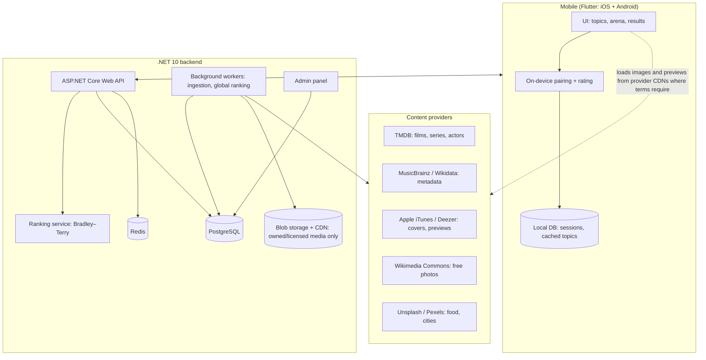
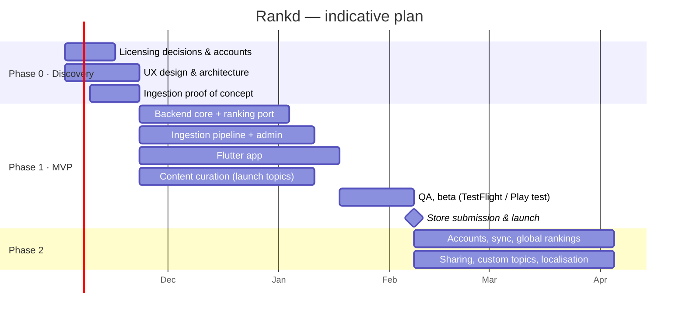

# Rankd — Concept Plan & Project Scope

**Mobile app (Flutter) · Backend (.NET) · Licensed media catalogue**

| | |
|---|---|
| **Document** | Concept plan and scope, v0.1 (draft for review) |
| **Date** | 18 October 2026 |
| **Owner** | Mehdi Javadov |
| **Status** | For decision: open questions in §17 must be answered before build starts |
| **Reference** | Working web prototype: <https://mehdicavad.github.io/hellonewworld/> |

---

## 1. Executive summary

Rankd lets people rank anything by answering one question over and over: *this one or that one?* The user picks a topic (movies, actors, footballers, songs, food, cities, and more) and a depth level. They then compare pairs of rich media cards — a film poster, an actor's photo, a song's 30-second preview — and finish with a full personal ranking. Every user's answers also feed a **global community ranking** per topic.

A working web prototype already exists and proves the core mechanics. It includes the ranking model, adaptive pairing, levels, two game modes, media and a minimal design, with 39 automated tests. This project turns that prototype into a production product:

- a **Flutter** app for iOS and Android;
- a **.NET** backend for accounts, sync and global rankings;
- a **content pipeline** that sources metadata and media from providers we are licensed to use.

The engineering is conventional. **The critical path is content licensing.** Posters, celebrity photos and music previews are copyrighted, and the terms differ by provider and by whether the app is commercial. Those decisions must be made in the first two weeks, before any media code is written.

---

## 2. Concept

### 2.1 The problem

Ratings out of ten are noisy and tiring: people are inconsistent with absolute scores and anchor on the first few items. Pairwise choice is easy, fast and fun — anyone can say which of two films they prefer. A sound statistical model turns a few dozen of those choices into an accurate ordered list.

### 2.2 The core loop

```
Choose topic ─► Choose level ─► Compare pairs (tap one) ─► See ranking ─► Share / refine / compare with community
```

### 2.3 Key concepts

| Concept | Meaning |
|---|---|
| **Topic** | A themed catalogue: Movies, TV Series, Actors, Footballers, Music Artists, Songs, Food, Cities, Programming Languages, user-created lists |
| **Level** | Sets pool size and depth of the catalogue. *Casual* (8 household names), *Standard* (16), *Expert* (24 including deep cuts), *Marathon* (whole topic) |
| **Mode** | *Smart duels*: the app serves the pair it is least sure about (fewest taps, sharpest ranking). *King of the hill*: the winner stays on screen and defends against new challengers |
| **Personal ranking** | One user's ordered list for a topic, with strength and win/loss record |
| **Global ranking** | All users' comparisons combined into one community ordering per topic |
| **Media card** | Option name and detail, plus image (poster, photo or cover) and, for songs, a playable 30-second preview |

### 2.4 Rules that make it feel fair

- An option never appears in two consecutive rounds, and no pair is asked twice while unasked pairs remain. The King of the hill champion is the deliberate exception.
- Left/right position is randomised, so screen position never biases the result.
- Users can undo, skip a pair, or call a tie ("too close to call").

---

## 3. Goals and success measures

| Goal | Measure | MVP target (indicative) |
|---|---|---|
| People enjoy it and come back | Day-7 retention | ≥ 20 % |
| Sessions get finished | Started sessions reaching results | ≥ 60 % |
| Rankings are trustworthy | Rank error vs. known order in simulation (existing test) | ≤ 1 position at 10 % noisy answers |
| Media feels rich | Cards shown with an image | ≥ 90 % for posters and photos |
| Reliable app | Crash-free sessions | ≥ 99.5 % |
| Fast backend | API p95 latency | < 300 ms |
| Licensing hygiene | Assets with a recorded licence and source | 100 % |
| Takedown readiness | Time to remove a disputed asset | < 1 hour, no app release needed |

---

## 4. Target users

| Persona | Need | What they value |
|---|---|---|
| **The casual player** | A few minutes of light fun | Fast taps, beautiful cards, a shareable result |
| **The enthusiast** | A definitive "my top 50 films" | Expert and Marathon depth, refine further, accuracy |
| **The social sharer** | Start debates with friends | Share cards, compare with the community and friends |
| **The curator** (Phase 2) | Rank a personal list (albums, local restaurants) | Custom topics with their own items |

---

## 5. Scope

### 5.1 MVP — Phase 1

**Mobile app (Flutter, iOS and Android)**

- Topic list, level picker, mode picker
- Arena: two side-by-side media cards, tap to choose, tie, skip, undo, finish early, progress
- King of the hill with the champion frozen in its position
- Song cards with play/stop preview and progress
- Results: winner, full ranked table with strength, win/loss/tie, "low data" flags
- Resume unfinished sessions; history of finished rankings
- Offline play for an already downloaded topic (answers sync later)
- Attribution and licences screen; source link per item
- Light and dark themes
- Anonymous use, no login required

**Backend (.NET)**

- Catalogue API: topics, levels, items, media references
- Session and comparison API (idempotent, works offline-first)
- Ranking service: Bradley–Terry fit and adaptive pairing, ported from the prototype
- Ingestion workers that pull metadata and media references from providers
- Admin panel: curate items, assign tiers, fix wrong matches, disable an asset
- Asset licence registry and per-asset kill switch
- Monitoring, logging, rate limiting

**Content**

- 6–8 launch topics, about 200–400 curated items each
- Every asset has a source, licence and attribution stored

### 5.2 Phase 2

- Accounts (Apple, Google, email) with cross-device sync
- **Global community rankings** per topic, with anti-abuse controls
- Share-as-image ranking cards for social apps
- User-created topics, with moderation
- Localisation (Azerbaijani, English, Russian — to be confirmed)
- Push notifications for new topics

### 5.3 Phase 3

- Friends, "compare with a friend", head-to-head
- Trending and seasonal topics, editorial picks
- Monetisation (ads or a premium tier), if chosen in §17
- Web version built on the same API

### 5.4 Out of scope

| Item | Reason |
|---|---|
| Hosting our own copies of posters, covers or song audio without a licence | Copyright exposure |
| Full-length music streaming | Requires label licensing |
| Guaranteed "chorus" clips | No public API provides chorus timestamps. Apple and Deezer choose their own 30-second segment, usually the hook but not guaranteed. True chorus clips require licensing audio directly |
| Video trailers | Phase 3 at the earliest; licensing to be assessed |

---

## 6. Functional requirements (MVP)

| ID | Requirement |
|---|---|
| FR-01 | The user can browse topics, each showing item count and a short description |
| FR-02 | The user can choose a level; the app shows options and expected number of taps |
| FR-03 | The user can choose Smart duels or King of the hill |
| FR-04 | The arena shows two options side by side at every screen size, with image, name and detail |
| FR-05 | Tapping an option records the answer immediately; no tap is ever dropped |
| FR-06 | The user can tie, skip, undo (exactly restores the previous state) and finish early |
| FR-07 | No option appears in two consecutive rounds; no pair repeats while unasked pairs remain |
| FR-08 | In King of the hill, the champion keeps its screen position and is visibly marked |
| FR-09 | Song cards play a 30-second preview; playing does not count as a choice; a new pair stops playback |
| FR-10 | Results show rank, name, image, strength, win/loss/tie and low-confidence flags |
| FR-11 | The user can refine a finished ranking with more rounds |
| FR-12 | Unfinished sessions can be resumed after the app is closed |
| FR-13 | A downloaded topic can be played offline; answers sync when online |
| FR-14 | Each item links to its source; an attribution screen lists all providers |
| FR-15 | An admin can edit items and tiers, re-match media and disable any asset instantly |
| FR-16 | If media fails to load, the card falls back cleanly to text |

---

## 7. Non-functional requirements

| Area | Requirement |
|---|---|
| Performance | App cold start < 2 s on mid-range devices; next pair < 100 ms (computed on device); API p95 < 300 ms |
| Availability | Backend ≥ 99.5 % monthly; the app keeps working offline for downloaded topics |
| Scalability | Global ranking recomputation as a background job, not on the request path |
| Security | HTTPS only, OWASP API Top 10 controls, secrets in a vault, rate limiting per device and IP |
| Privacy | Compliance with the Law of the Republic of Azerbaijan on Personal Data; GDPR if serving EU users; data minimisation (anonymous by default); in-app account deletion (an App Store requirement once accounts exist) |
| Accessibility | Screen-reader labels, sufficient contrast in both themes, large tap targets, reduced-motion support |
| Licensing | Provider terms enforced in code: attribution text, hotlinking where required, cache lifetimes, rate limits |
| Observability | Structured logs, metrics, distributed tracing, crash reporting |
| Quality | Automated tests in CI; the prototype's 39 ranking tests become acceptance tests for the C# port |

---

## 8. Solution architecture



### 8.1 Mobile (Flutter)

| Concern | Choice |
|---|---|
| State management | Riverpod (or Bloc) |
| Navigation | go_router |
| Networking | dio, with retry and offline queue |
| Images | cached_network_image |
| Audio | just_audio |
| Local storage | drift (SQLite) or Isar |
| Analytics and crashes | Firebase Analytics + Crashlytics, or Sentry |
| Engine | Pairing and rating run on the device for instant response; the server stays the source of truth for global data |

### 8.2 Backend (.NET)

| Concern | Choice |
|---|---|
| Runtime | .NET 10 (LTS), ASP.NET Core Web API |
| Data | PostgreSQL + EF Core |
| Cache and rate limits | Redis |
| Background jobs | Hangfire or Quartz.NET |
| Auth (Phase 2) | ASP.NET Core Identity or an OIDC provider; Sign in with Apple and Google |
| Media | Blob storage + CDN, only for assets we own or are licensed to store |
| Hosting | Azure (natural fit for .NET) or AWS — decision in §17 |
| CI/CD | GitHub Actions, Docker |
| Tests | xUnit, integration tests with Testcontainers |

---

## 9. Content and media strategy

### 9.1 Sources by topic

| Topic | Metadata | Images / audio | Licensing position |
|---|---|---|---|
| Movies, TV series | TMDB | TMDB posters and backdrops | Free for non-commercial use. **A commercial app requires a TMDB commercial licence.** Mandatory attribution: "This product uses the TMDB API but is not endorsed or certified by TMDB." |
| Actors | TMDB, Wikidata | TMDB profile images, Wikimedia Commons | As above. Using a person's likeness in a commercial product raises right-of-publicity questions — legal review needed |
| Songs | MusicBrainz (CC0 core data) | Apple iTunes Search API: cover art + 30-second previews; Deezer API as an alternative | Previews must link back to the store and be used to promote the track. Spotify no longer provides preview clips to new apps. Audio is never rehosted |
| Music artists | MusicBrainz, Wikidata | Wikimedia Commons, Apple artist artwork | Commons licences vary per file (CC BY, CC BY-SA, public domain); attribution required |
| Footballers | Wikidata | Wikimedia Commons | Commercial sports-photo agencies are costly; likeness caution as for actors |
| Food, cities | Wikidata | Unsplash, Pexels, Wikimedia Commons | Unsplash permits commercial use but requires hotlinking, credit to the photographer, and registering downloads |
| Custom topics (Phase 2) | User-entered | Wikipedia lookup or user upload (moderated) | User uploads need terms of use and moderation |

### 9.2 Rules for every asset

1. **Record provenance.** Store provider, provider ID, source URL, licence, attribution text and retrieval date with every asset.
2. **Obey each provider's terms in code.** Attribution, hotlinking versus copying, cache lifetimes and rate limits are enforced by the ingestion service, not left to people.
3. **Kill switch.** Any asset can be disabled from the admin panel and disappears from the app without a release.
4. **Human curation.** Automated matching makes mistakes ("Parasite" the film versus the organism; two songs with the same title). Every launch item is reviewed.
5. **Graceful fallback.** A missing or blocked image never blocks play; the card shows text.

### 9.3 Provider limits to design around (to be re-verified at contract time)

| Provider | Notable constraint |
|---|---|
| Apple iTunes Search API | Roughly 20 requests per minute; no key |
| MusicBrainz | 1 request per second; identifying User-Agent required |
| Unsplash | 50 requests/hour in demo mode, higher after production approval |
| Pexels | Hourly and monthly quotas on the free tier |
| TMDB | Fair-use rate limits; commercial terms negotiated separately |

Because of these limits, **the backend ingests and caches metadata in advance**. The app reads from our API, not from providers, except where a provider requires hotlinking images directly from its CDN.

---

## 10. Data model (core entities)

| Entity | Key fields |
|---|---|
| **Topic** | id, name, icon, description, media kind, active |
| **Item** | id, topic, name, detail (year/country/artist), tier (1–3), external IDs (TMDB, MusicBrainz, Wikidata) |
| **Asset** | id, item, type (image/audio), URL, provider, provider ID, licence, attribution, hotlink-only flag, retrieved at, enabled |
| **Level** | id, name, tiers included, pool size, round budget |
| **Session** | id, user/device, topic, level, mode, seed, status, created/updated |
| **Comparison** | id, session, item A, item B, winner (A/B/tie), timestamp, client sequence number |
| **PersonalRanking** | session, item, rating, wins, losses, ties, confidence |
| **GlobalRanking** | topic, item, rating, comparisons count, computed at |
| **User** (Phase 2) | id, auth provider, display name, created, deleted at |

The comparison history is the source of truth. Ratings are always re-derived from it, which makes undo exact and audit simple.

---

## 11. Ranking methodology

- **Model: Bradley–Terry.** Each item has a strength *p*; item *i* beats *j* with probability *pᵢ / (pᵢ + pⱼ)*. All strengths are fitted together from every comparison, so beating a strong item counts for more than beating a weak one. The fit uses Hunter's MM algorithm, regularised so undefeated or winless items still get finite ratings.
- **Adaptive pairing.** Each round serves the most informative pair: close in current rating, never asked before, involving under-sampled items, and not repeating the previous round.
- **Proven in the prototype.** In simulation, 16 items are ordered exactly within the default budget, and accuracy stays within about one position when 10 % of answers are inconsistent.
- **Global ranking (Phase 2).** The same model fitted over all users' comparisons per topic, computed in a background job. Weighting and anti-manipulation rules (per-device caps, anomaly detection) are part of Phase 2 design.

---

## 12. Team and skills

| Role | Priority | Load (MVP) | Responsibilities | Key skills |
|---|---|---|---|---|
| **Content & licensing advisor** | 🔴 Urgent | Part-time, retainer | Commercial versus non-commercial position, TMDB licence, likeness review, attribution and takedown policy, terms of use, privacy policy | IP and copyright, API terms of service, media licensing, data-protection law |
| **Product owner / content curator** | 🔴 Urgent | 1 FTE | Backlog, topic lists, tiering, match quality, acceptance | Product management, domain knowledge (film, music, sport), writing requirements |
| **.NET backend developer** | 🔴 Urgent | 1 FTE | API, ranking port, sync, admin, global rankings | ASP.NET Core, EF Core, PostgreSQL, Redis, REST design, xUnit, security |
| **Data / integration engineer** | 🔴 Urgent | 1 FTE (may combine with backend in a lean team) | Provider clients, ingestion jobs, entity matching, licence registry | REST integrations, rate limiting, ETL, Hangfire/Quartz, data quality, Wikidata/SPARQL |
| **Flutter developer** | 🟠 Now | 1–2 FTE | The mobile app, offline sync, audio, store releases | Dart, Flutter, Riverpod/Bloc, go_router, dio, just_audio, drift/Isar, App Store and Play Store publishing |
| **UI/UX designer** | 🟠 Now | 0.5 FTE | Mobile design from the prototype's minimal design system, prototypes, usability tests | Figma, mobile interaction design, accessibility |
| **DevOps / cloud engineer** | 🟡 Part-time | 0.25–0.5 FTE | CI/CD, environments, CDN, monitoring, backups | Azure or AWS, Docker, GitHub Actions, observability |
| **QA engineer** | 🟡 From week 4 | 0.5–1 FTE | Test plans, device matrix, regression, store compliance | Mobile testing, API testing, test automation |

**Lean option (about 4 people):** a full-stack .NET developer who also owns ingestion, one Flutter developer, a designer who also acts as product owner, and a licensing advisor on retainer.

---

## 13. Delivery plan (indicative)

Durations assume the core team in §12 starts together. They are planning estimates to be re-baselined after the discovery phase.



| Milestone | Indicative timing | Exit criteria |
|---|---|---|
| M0 · Discovery done | ~3 weeks | Licensing position decided, provider accounts active, designs approved, ingestion PoC shows ≥ 95 % correct matches on a sample topic |
| M1 · Feature complete | ~11–12 weeks | All MVP functional requirements implemented; ranking port passes the prototype's tests |
| M2 · Beta | ~13–14 weeks | Closed beta on TestFlight and Play internal testing; crash-free ≥ 99 % |
| M3 · Launch | ~15–16 weeks | Store approval; monitoring and takedown process live |
| M4 · Phase 2 complete | +8–10 weeks | Accounts, global rankings, sharing, localisation |

---

## 14. Cost drivers

Figures to be confirmed; listed so the budget covers every line.

| Item | Note |
|---|---|
| Team | The largest cost; see §12 |
| Apple Developer Program | USD 99 per year |
| Google Play Console | USD 25 one-time |
| TMDB commercial licence | Only if commercial; price on negotiation |
| Cloud hosting | API, PostgreSQL, Redis, storage, CDN; modest at MVP scale |
| Monitoring and crash reporting | Free tiers likely sufficient for the MVP |
| Legal | Licensing review, terms of use, privacy policy |
| Design tools | Figma seats |

---

## 15. Risks and mitigations

| # | Risk | Likelihood | Impact | Mitigation |
|---|---|---|---|---|
| R1 | Commercial use of posters or celebrity images without the right licence | High if unmanaged | High | Licensing advisor from day 1; TMDB commercial licence; Commons-only fallback; per-asset kill switch |
| R2 | A provider changes its terms or removes an API (as Spotify did with previews) | Medium | High | Provider abstraction layer with at least two sources per media type; text fallback |
| R3 | Wrong media matched to an item | High | Medium | Explicit external IDs, human review, admin re-match tool |
| R4 | Provider rate limits slow ingestion | Medium | Low | Pre-ingest and cache in the backend; scheduled jobs; back-off |
| R5 | App store rejection (metadata, privacy, third-party content) | Medium | Medium | Store guidelines review in design phase; attribution screen; privacy labels |
| R6 | Global rankings manipulated by bots | Medium (Phase 2) | Medium | Device attestation, per-device caps, anomaly detection, weighting |
| R7 | Low retention after novelty | Medium | High | Fresh topics, sharing, friend comparisons, notifications for new topics |
| R8 | Scope creep before launch | Medium | Medium | Fixed MVP scope (§5.1); change control through the product owner |

---

## 16. Assumptions and dependencies

- The ranking engine and rules from the web prototype are the functional specification for both the app and the backend.
- Launch markets and languages will be confirmed in §17.
- Providers' APIs remain available on current terms during the build.
- Media are loaded from provider CDNs where required by their terms; we store only what we are licensed to store.
- The MVP needs no login; accounts arrive in Phase 2.

---

## 17. Decisions required

| # | Decision | Options | Why it matters |
|---|---|---|---|
| D1 | **Commercial or non-commercial at launch?** | Free with no revenue / ads / premium | Determines TMDB licensing, legal cost and which media sources are allowed |
| D2 | Launch markets and languages | Azerbaijan only / region / global; az, en, ru | Localisation effort, privacy law scope, catalogue choices (e.g. local food and cities) |
| D3 | Accounts in the MVP? | Anonymous first (recommended) / login from day 1 | Scope, privacy obligations, time to launch |
| D4 | Cloud provider | Azure (recommended for .NET) / AWS | Hosting, CI/CD, team skills |
| D5 | Launch topics | Keep the prototype's nine / choose 6–8 | Curation effort and licensing exposure |
| D6 | Team model | In-house / agency / mixed | Cost, speed, long-term ownership |

---

## 18. Next steps (first two weeks)

1. Decide D1 and D3, and engage the licensing advisor.
2. Register accounts: TMDB API, Apple Developer, Google Play Console, Unsplash, Pexels.
3. Freeze launch topics and target item counts (D5).
4. Build the ingestion proof of concept for one topic per provider and measure match accuracy.
5. Port the ranking engine to C# and make the prototype's 39 tests pass.
6. Produce UX designs for the four core screens: topics, level picker, arena, results.

---

## Appendix A — What the prototype already proves

| Capability | Status in the web prototype |
|---|---|
| Bradley–Terry ranking with adaptive pairing | Done, tested in simulation |
| Levels, Smart duels, King of the hill with frozen champion | Done |
| No consecutive repeats, no repeated pairs | Done, tested |
| Undo, skip, tie, refine, resume | Done |
| Posters, photos, covers and 30-second song previews | Done against mocked providers; live check pending on GitHub Pages |
| Minimal light/dark design, mobile layout | Done |
| Single-file build for WebView packaging | Done |
| Accounts, sync, global rankings, licensing compliance | **Not started** — scope of this project |

## Appendix B — Glossary

| Term | Meaning |
|---|---|
| **Bradley–Terry** | A statistical model that estimates each item's strength from pairwise wins and losses |
| **Hotlinking** | Displaying an image directly from the provider's server instead of copying it |
| **CC0 / CC BY / CC BY-SA** | Creative Commons licences: public domain / attribution required / attribution and share-alike |
| **Right of publicity** | A person's right to control commercial use of their likeness |
| **LTS** | Long-term support release |
