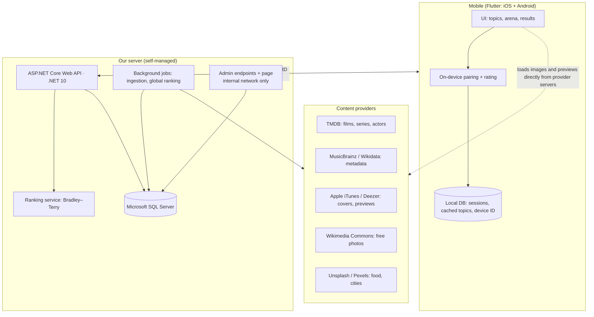
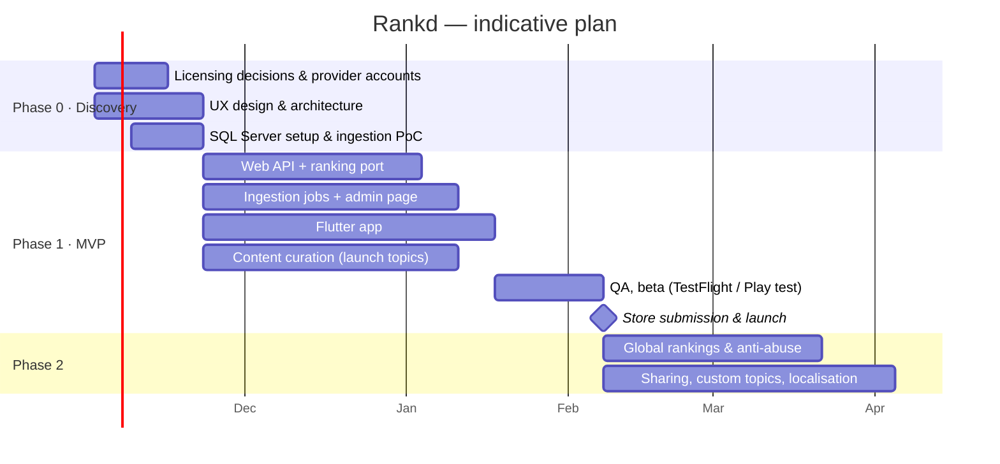

# Rankd — Concept Plan & Project Scope

**Mobile app (Flutter) · .NET Core Web API · Microsoft SQL Server**

| | |
|---|---|
| **Document** | Concept plan and scope, v0.2 (draft for review) |
| **Date** | 18 October 2026 |
| **Owner** | Mehdi Javadov |
| **Status** | For decision: open questions in §17 must be answered before build starts |
| **Reference** | Working web prototype: <https://mehdicavad.github.io/hellonewworld/> |

### Change log

| Version | Change |
|---|---|
| v0.1 | First draft |
| v0.2 | Backend fixed as an ASP.NET Core Web API on **Microsoft SQL Server**. **Removed from this phase:** cloud hosting providers, CI/CD, and authentication / user accounts. Architecture, requirements, team, plan, costs and risks updated to match |

---

## 1. Executive summary

Rankd lets people rank anything by answering one question over and over: *this one or that one?* The user picks a topic (movies, actors, footballers, songs, food, cities, and more) and a depth level. They then compare pairs of rich media cards — a film poster, an actor's photo, a song's 30-second preview — and finish with a full personal ranking. All users' answers also feed a **global community ranking** per topic.

A working web prototype already exists and proves the core mechanics. It includes the ranking model, adaptive pairing, levels, two game modes, media and a minimal design, with 39 automated tests. This project turns that prototype into a production product:

- a **Flutter** app for iOS and Android;
- an **ASP.NET Core Web API** (.NET 10) with **Microsoft SQL Server** as the database;
- a **content pipeline** that sources metadata and media from providers we are licensed to use.

This phase deliberately stays lean: **no cloud hosting provider, no CI/CD pipeline and no user authentication.** The API and SQL Server run on a server we manage ourselves, and the app is used anonymously.

The engineering is conventional. **The critical path is content licensing.** Posters, celebrity photos and music previews are copyrighted, and the terms differ by provider and by whether the app is commercial. Those decisions must be made in the first two weeks, before any media code is written.

---

## 2. Concept

### 2.1 The problem

Ratings out of ten are noisy and tiring: people are inconsistent with absolute scores and anchor on the first few items. Pairwise choice is easy, fast and fun — anyone can say which of two films they prefer. A sound statistical model turns a few dozen of those choices into an accurate ordered list.

### 2.2 The core loop

```
Choose topic ─► Choose level ─► Compare pairs (tap one) ─► See ranking ─► Share / refine / compare with community
```

### 2.3 Key concepts

| Concept | Meaning |
|---|---|
| **Topic** | A themed catalogue: Movies, TV Series, Actors, Footballers, Music Artists, Songs, Food, Cities, Programming Languages, user-created lists |
| **Level** | Sets pool size and depth of the catalogue. *Casual* (8 household names), *Standard* (16), *Expert* (24 including deep cuts), *Marathon* (whole topic) |
| **Mode** | *Smart duels*: the app serves the pair it is least sure about (fewest taps, sharpest ranking). *King of the hill*: the winner stays on screen and defends against new challengers |
| **Personal ranking** | One device's ordered list for a topic, with strength and win/loss record |
| **Global ranking** | All devices' comparisons combined into one community ordering per topic |
| **Media card** | Option name and detail, plus image (poster, photo or cover) and, for songs, a playable 30-second preview |
| **Device ID** | A random identifier the app creates on first launch. It replaces user accounts: it groups a device's sessions on the server, and it carries no personal details |

### 2.4 Rules that make it feel fair

- An option never appears in two consecutive rounds, and no pair is asked twice while unasked pairs remain. The King of the hill champion is the deliberate exception.
- Left/right position is randomised, so screen position never biases the result.
- Users can undo, skip a pair, or call a tie ("too close to call").

---

## 3. Goals and success measures

| Goal | Measure | MVP target (indicative) |
|---|---|---|
| People enjoy it and come back | Day-7 retention | ≥ 20 % |
| Sessions get finished | Started sessions reaching results | ≥ 60 % |
| Rankings are trustworthy | Rank error vs. known order in simulation (existing test) | ≤ 1 position at 10 % noisy answers |
| Media feels rich | Cards shown with an image | ≥ 90 % for posters and photos |
| Reliable app | Crash-free sessions | ≥ 99.5 % |
| Fast backend | API p95 latency on our server | < 300 ms |
| Licensing hygiene | Assets with a recorded licence and source | 100 % |
| Takedown readiness | Time to remove a disputed asset | < 1 hour, no app release needed |

---

## 4. Target users

| Persona | Need | What they value |
|---|---|---|
| **The casual player** | A few minutes of light fun | Fast taps, beautiful cards, a shareable result |
| **The enthusiast** | A definitive "my top 50 films" | Expert and Marathon depth, refine further, accuracy |
| **The social sharer** | Start debates with friends | Share cards, compare with the community |
| **The curator** (Phase 2) | Rank a personal list (albums, local restaurants) | Custom topics with their own items |

---

## 5. Scope

### 5.1 MVP — Phase 1

**Mobile app (Flutter, iOS and Android)**

- Topic list, level picker, mode picker
- Arena: two side-by-side media cards, tap to choose, tie, skip, undo, finish early, progress
- King of the hill with the champion frozen in its position
- Song cards with play/stop preview and progress
- Results: winner, full ranked table with strength, win/loss/tie, "low data" flags
- Resume unfinished sessions; history of finished rankings on the device
- Offline play for an already downloaded topic (answers upload when back online)
- Attribution and licences screen; source link per item
- Light and dark themes
- Anonymous use: no sign-up, no login; a random device ID is created on first launch

**Backend — ASP.NET Core Web API (.NET 10) + Microsoft SQL Server**

- Catalogue endpoints: topics, levels, items, media references
- Session and comparison endpoints (idempotent, offline-first, keyed by device ID)
- Ranking service: Bradley–Terry fit and adaptive pairing, ported from the prototype
- Ingestion jobs that pull metadata and media references from content providers into SQL Server
- Admin endpoints and a simple admin page: curate items, assign tiers, fix wrong matches, disable an asset — reachable only from the internal network (see §7)
- Asset licence registry and per-asset kill switch
- Structured logging and API rate limiting

**Content**

- 6–8 launch topics, about 200–400 curated items each
- Every asset has a source, licence and attribution stored

### 5.2 Phase 2

- **Global community rankings** per topic, with anti-abuse controls based on device ID and rate limits
- Share-as-image ranking cards for social apps
- User-created topics, with moderation
- Localisation (Azerbaijani, English, Russian — to be confirmed)

### 5.3 Phase 3

- Trending and seasonal topics, editorial picks
- Monetisation (ads or a premium tier), if chosen in §17
- Web version built on the same API

### 5.4 Out of scope

| Item | Reason |
|---|---|
| **Cloud or third-party hosting providers** | Not needed for this phase. The API and SQL Server run on a server we manage |
| **CI/CD pipelines** | Not needed for this phase. Builds and releases are done manually with a release checklist (§7) |
| **Authentication, user accounts, sign-in, cross-device sync, friends** | Not needed for this phase. The app is anonymous; a random device ID groups a device's data. Anything that needs a known identity is excluded |
| Media storage on our server (blob storage, CDN) | Media are referenced from provider servers; we store no image or audio files in this phase |
| Hosting our own copies of posters, covers or song audio without a licence | Copyright exposure |
| Full-length music streaming | Requires label licensing |
| Guaranteed "chorus" clips | No public API provides chorus timestamps. Apple and Deezer choose their own 30-second segment, usually the hook but not guaranteed. True chorus clips require licensing audio directly |
| Video trailers | Phase 3 at the earliest; licensing to be assessed |

---

## 6. Functional requirements (MVP)

| ID | Requirement |
|---|---|
| FR-01 | The user can browse topics, each showing item count and a short description |
| FR-02 | The user can choose a level; the app shows options and expected number of taps |
| FR-03 | The user can choose Smart duels or King of the hill |
| FR-04 | The arena shows two options side by side at every screen size, with image, name and detail |
| FR-05 | Tapping an option records the answer immediately; no tap is ever dropped |
| FR-06 | The user can tie, skip, undo (exactly restores the previous state) and finish early |
| FR-07 | No option appears in two consecutive rounds; no pair repeats while unasked pairs remain |
| FR-08 | In King of the hill, the champion keeps its screen position and is visibly marked |
| FR-09 | Song cards play a 30-second preview; playing does not count as a choice; a new pair stops playback |
| FR-10 | Results show rank, name, image, strength, win/loss/tie and low-confidence flags |
| FR-11 | The user can refine a finished ranking with more rounds |
| FR-12 | Unfinished sessions can be resumed after the app is closed |
| FR-13 | A downloaded topic can be played offline; answers upload to the API when online |
| FR-14 | Each item links to its source; an attribution screen lists all providers |
| FR-15 | An admin can edit items and tiers, re-match media and disable any asset instantly |
| FR-16 | If media fails to load, the card falls back cleanly to text |
| FR-17 | The app works without any sign-up; on first launch it creates a random device ID and sends it with every API call |
| FR-18 | The user can delete all data for their device from the app (clears local data and asks the API to delete that device's records) |

---

## 7. Non-functional requirements

| Area | Requirement |
|---|---|
| Performance | App cold start < 2 s on mid-range devices; next pair < 100 ms (computed on device); API p95 < 300 ms on our server |
| Availability | Best effort on a single self-managed server; the app keeps working offline for downloaded topics |
| Database | Microsoft SQL Server; schema managed with EF Core migrations; scheduled full and log backups with a tested restore |
| Scalability | Global ranking recomputation as a background job, not on the request path |
| Security | HTTPS only, OWASP API Top 10 controls, secrets kept out of source code, ASP.NET Core rate limiting per device ID and IP. **With no authentication, the public API exposes only catalogue reads and device-scoped writes;** admin endpoints listen on the internal network only (separate port or IP allow-list) |
| Privacy | No names, emails or accounts are collected. Device IDs and comparison data are still treated as personal data under the Law of the Republic of Azerbaijan on Personal Data (and GDPR if serving EU users); data minimisation; per-device deletion (FR-18) |
| Accessibility | Screen-reader labels, sufficient contrast in both themes, large tap targets, reduced-motion support |
| Licensing | Provider terms enforced in code: attribution text, hotlinking where required, cache lifetimes, rate limits |
| Observability | Structured logs (Serilog), request logging, crash reporting in the app |
| Release process | No CI/CD. Every release follows a written checklist: run all unit and integration tests locally, apply and verify EF Core migrations on a backup copy, publish the API manually, and build the app locally for the App Store and Google Play |
| Quality | Automated tests run locally before each release; the prototype's 39 ranking tests become acceptance tests for the C# port |

---

## 8. Solution architecture



There is no media storage on our side: SQL Server holds the URLs, licences and attribution, and the app loads the files from the providers' own servers. This keeps the server small and respects providers that require hotlinking.

### 8.1 Mobile (Flutter)

| Concern | Choice |
|---|---|
| State management | Riverpod (or Bloc) |
| Navigation | go_router |
| Networking | dio, with retry and offline upload queue |
| Images | cached_network_image |
| Audio | just_audio |
| Local storage | drift (SQLite) or Isar |
| Device ID | A random UUID generated on first launch and stored locally |
| Crash reporting | Sentry or Firebase Crashlytics |
| Engine | Pairing and rating run on the device for instant response; the server stays the source of truth for the catalogue and global rankings |

### 8.2 Backend — ASP.NET Core Web API

| Concern | Choice |
|---|---|
| Runtime | .NET 10 (LTS), ASP.NET Core Web API (controllers or minimal APIs) |
| Database | **Microsoft SQL Server** |
| Data access | EF Core with the SQL Server provider; migrations for schema changes |
| Caching | In-process memory cache (`IMemoryCache` / output caching) for catalogue reads — no separate cache server |
| Rate limiting | ASP.NET Core built-in rate-limiting middleware, partitioned by device ID and IP |
| Background jobs | Hangfire with SQL Server storage (jobs and their dashboard live in the same database), or a .NET `BackgroundService` for simpler schedules |
| API documentation | OpenAPI (built into ASP.NET Core) for the Flutter team |
| Logging | Serilog to file and/or a SQL Server log table |
| Tests | xUnit; integration tests against a local SQL Server instance (Developer or Express edition) |
| Authentication | **None in this phase** (see §5.4 and §7 for how the API is protected without it) |

### 8.3 SQL Server notes

- **Edition:** Developer edition for development and testing (free, non-production only). For production, Express (free, with a capped database size and limited memory and CPU) is likely enough for the MVP catalogue and comparison volume; Standard if limits are reached. The exact limits are to be checked against the version chosen (decision D3).
- **Key indexes:** comparisons by session and by topic; items by topic and tier; assets by item and enabled flag.
- **Global ranking job:** reads comparisons per topic in batches and writes a `GlobalRanking` snapshot, so the app reads a precomputed table.
- **Backups:** nightly full backup plus transaction-log backups; a restore test before launch.

---

## 9. Content and media strategy

### 9.1 Sources by topic

| Topic | Metadata | Images / audio | Licensing position |
|---|---|---|---|
| Movies, TV series | TMDB | TMDB posters and backdrops | Free for non-commercial use. **A commercial app requires a TMDB commercial licence.** Mandatory attribution: "This product uses the TMDB API but is not endorsed or certified by TMDB." |
| Actors | TMDB, Wikidata | TMDB profile images, Wikimedia Commons | As above. Using a person's likeness in a commercial product raises right-of-publicity questions — legal review needed |
| Songs | MusicBrainz (CC0 core data) | Apple iTunes Search API: cover art + 30-second previews; Deezer API as an alternative | Previews must link back to the store and be used to promote the track. Spotify no longer provides preview clips to new apps. Audio is never rehosted |
| Music artists | MusicBrainz, Wikidata | Wikimedia Commons, Apple artist artwork | Commons licences vary per file (CC BY, CC BY-SA, public domain); attribution required |
| Footballers | Wikidata | Wikimedia Commons | Commercial sports-photo agencies are costly; likeness caution as for actors |
| Food, cities | Wikidata | Unsplash, Pexels, Wikimedia Commons | Unsplash permits commercial use but requires hotlinking, credit to the photographer, and registering downloads |
| Custom topics (Phase 2) | User-entered | Wikipedia lookup only (no uploads, since we store no media) | Moderation of names and descriptions |

### 9.2 Rules for every asset

1. **Record provenance.** Store provider, provider ID, source URL, licence, attribution text and retrieval date with every asset in SQL Server.
2. **Obey each provider's terms in code.** Attribution, hotlinking, cache lifetimes and rate limits are enforced by the ingestion jobs, not left to people.
3. **Kill switch.** Any asset can be disabled from the admin page and disappears from the app without a release.
4. **Human curation.** Automated matching makes mistakes ("Parasite" the film versus the organism; two songs with the same title). Every launch item is reviewed.
5. **Graceful fallback.** A missing or blocked image never blocks play; the card shows text.

### 9.3 Provider limits to design around (to be re-verified at contract time)

| Provider | Notable constraint |
|---|---|
| Apple iTunes Search API | Roughly 20 requests per minute; no key |
| MusicBrainz | 1 request per second; identifying User-Agent required |
| Unsplash | 50 requests/hour in demo mode, higher after production approval |
| Pexels | Hourly and monthly quotas on the free tier |
| TMDB | Fair-use rate limits; commercial terms negotiated separately |

Because of these limits, **the backend ingests metadata in advance and stores it in SQL Server.** The app reads the catalogue from our API, not from the providers. The only direct provider traffic from the app is loading the images and audio previews themselves.

---

## 10. Data model (core SQL Server tables)

| Table | Key columns |
|---|---|
| **Topic** | Id, Name, Icon, Description, MediaKind, IsActive |
| **Item** | Id, TopicId, Name, Detail (year/country/artist), Tier (1–3), TmdbId, MusicBrainzId, WikidataId |
| **Asset** | Id, ItemId, Type (image/audio), Url, Provider, ProviderId, Licence, Attribution, HotlinkOnly, RetrievedAt, IsEnabled |
| **Level** | Id, Name, Tiers, PoolSize, RoundBudget |
| **Device** | Id (random UUID from the app), FirstSeenAt, LastSeenAt |
| **Session** | Id, DeviceId, TopicId, LevelId, Mode, Seed, Status, CreatedAt, UpdatedAt |
| **Comparison** | Id, SessionId, ItemAId, ItemBId, Winner (A/B/tie), CreatedAt, ClientSequence (for idempotent offline upload) |
| **PersonalRanking** | SessionId, ItemId, Rating, Wins, Losses, Ties, Confidence |
| **GlobalRanking** | TopicId, ItemId, Rating, ComparisonCount, ComputedAt |

There is no User table: the Device table replaces it. The comparison history is the source of truth. Ratings are always re-derived from it, which makes undo exact and audit simple.

---

## 11. Ranking methodology

- **Model: Bradley–Terry.** Each item has a strength *p*; item *i* beats *j* with probability *pᵢ / (pᵢ + pⱼ)*. All strengths are fitted together from every comparison, so beating a strong item counts for more than beating a weak one. The fit uses Hunter's MM algorithm, regularised so undefeated or winless items still get finite ratings.
- **Adaptive pairing.** Each round serves the most informative pair: close in current rating, never asked before, involving under-sampled items, and not repeating the previous round.
- **Proven in the prototype.** In simulation, 16 items are ordered exactly within the default budget, and accuracy stays within about one position when 10 % of answers are inconsistent.
- **Global ranking (Phase 2).** The same model fitted over all devices' comparisons per topic, computed in a background job. Without accounts, anti-manipulation relies on per-device caps, IP rate limits, ignoring sessions that are too fast or too uniform, and down-weighting devices with anomalous patterns.

---

## 12. Team and skills

| Role | Priority | Load (MVP) | Responsibilities | Key skills |
|---|---|---|---|---|
| **Content & licensing advisor** | 🔴 Urgent | Part-time, retainer | Commercial versus non-commercial position, TMDB licence, likeness review, attribution and takedown policy, terms of use, privacy policy | IP and copyright, API terms of service, media licensing, data-protection law |
| **Product owner / content curator** | 🔴 Urgent | 1 FTE | Backlog, topic lists, tiering, match quality, acceptance | Product management, domain knowledge (film, music, sport), writing requirements |
| **.NET backend developer** | 🔴 Urgent | 1 FTE | Web API, ranking port, offline upload, admin page, global rankings, server setup and releases | C#, ASP.NET Core Web API, EF Core, REST design, xUnit, OWASP API security, rate limiting, IIS or Kestrel deployment |
| **SQL Server / data engineer** | 🔴 Urgent | 1 FTE (may combine with backend in a lean team) | Schema and indexes, ingestion jobs, entity matching, licence registry, backups and restore | Microsoft SQL Server, T-SQL, query tuning and indexing, backup/restore, EF Core migrations, Hangfire, REST integrations, Wikidata/SPARQL |
| **Flutter developer** | 🟠 Now | 1–2 FTE | The mobile app, offline queue, audio, manual store builds and submission | Dart, Flutter, Riverpod/Bloc, go_router, dio, just_audio, drift/Isar, App Store and Play Store publishing |
| **UI/UX designer** | 🟠 Now | 0.5 FTE | Mobile design from the prototype's minimal design system, prototypes, usability tests | Figma, mobile interaction design, accessibility |
| **QA engineer** | 🟡 From week 4 | 0.5–1 FTE | Test plans, device matrix, regression, release checklist sign-off | Mobile testing, API testing (Postman or similar), SQL for test data |

No DevOps or cloud role is needed in this phase, since there is no hosting provider and no CI/CD.

**Lean option (about 4 people):** a full-stack .NET developer with strong SQL Server skills who also owns ingestion, one Flutter developer, a designer who also acts as product owner, and a licensing advisor on retainer.

---

## 13. Delivery plan (indicative)

Durations assume the core team in §12 starts together. They are planning estimates to be re-baselined after the discovery phase.



| Milestone | Indicative timing | Exit criteria |
|---|---|---|
| M0 · Discovery done | ~3 weeks | Licensing position decided, content-provider accounts active, designs approved, SQL Server installed, ingestion PoC shows ≥ 95 % correct matches on a sample topic |
| M1 · Feature complete | ~11–12 weeks | All MVP functional requirements implemented; ranking port passes the prototype's tests |
| M2 · Beta | ~13–14 weeks | Closed beta on TestFlight and Play internal testing; crash-free ≥ 99 %; backup restore tested |
| M3 · Launch | ~15–16 weeks | Store approval; release checklist complete; takedown process live |
| M4 · Phase 2 complete | +6–8 weeks | Global rankings, sharing, custom topics, localisation |

---

## 14. Cost drivers

Figures to be confirmed; listed so the budget covers every line.

| Item | Note |
|---|---|
| Team | The largest cost; see §12 |
| Server | One machine we manage for the Web API and SQL Server (existing hardware or a purchased server), plus an SSL certificate and a domain or fixed address the app can reach |
| SQL Server licence | Developer and Express editions are free; Standard is paid and only needed if Express limits are reached |
| Apple Developer Program | USD 99 per year (needed to publish to the App Store) |
| Google Play Console | USD 25 one-time (needed to publish to Google Play) |
| TMDB commercial licence | Only if commercial; price on negotiation |
| Crash reporting | Free tiers likely sufficient for the MVP |
| Legal | Licensing review, terms of use, privacy policy |
| Design tools | Figma seats |

---

## 15. Risks and mitigations

| # | Risk | Likelihood | Impact | Mitigation |
|---|---|---|---|---|
| R1 | Commercial use of posters or celebrity images without the right licence | High if unmanaged | High | Licensing advisor from day 1; TMDB commercial licence; Commons-only fallback; per-asset kill switch |
| R2 | A provider changes its terms or removes an API (as Spotify did with previews) | Medium | High | Provider abstraction layer with at least two sources per media type; text fallback |
| R3 | Wrong media matched to an item | High | Medium | Explicit external IDs, human review, admin re-match tool |
| R4 | Provider rate limits slow ingestion | Medium | Low | Pre-ingest into SQL Server; scheduled jobs; back-off |
| R5 | App store rejection (metadata, privacy, third-party content) | Medium | Medium | Store guidelines review in design phase; attribution screen; privacy labels |
| R6 | Global rankings manipulated — easier without accounts | Medium (Phase 2) | Medium | Per-device caps, IP rate limits, filtering implausibly fast or uniform sessions, down-weighting anomalous devices |
| R7 | Unauthenticated API abused (spam writes, scraping) | Medium | Medium | Public API limited to catalogue reads and device-scoped writes; rate limiting; request size limits; admin endpoints on the internal network only |
| R8 | Single self-managed server fails or data is lost | Medium | High | Nightly full and log backups stored off the machine; tested restore; app keeps working offline meanwhile |
| R9 | Manual releases without CI/CD introduce mistakes | Medium | Medium | Written release checklist (§7); tests run locally before every release; migrations rehearsed on a backup copy |
| R10 | Users reinstall or change phones and lose their rankings | High | Low | Accepted for this phase (no accounts); share-as-image keeps results; revisit if users ask for sync |
| R11 | Low retention after novelty | Medium | High | Fresh topics, sharing, notifications for new topics (Phase 2) |
| R12 | Scope creep before launch | Medium | Medium | Fixed MVP scope (§5.1); change control through the product owner |

---

## 16. Assumptions and dependencies

- The ranking engine and rules from the web prototype are the functional specification for both the app and the backend.
- **No hosting provider, no CI/CD and no authentication in this phase.** The Web API and SQL Server run on a server we manage; releases are manual; the app is anonymous.
- The server has a stable address and an SSL certificate reachable by the mobile app.
- Content providers' APIs remain available on current terms during the build.
- Media are loaded from provider servers; we store only metadata, URLs, licences and attribution.
- Launch markets and languages will be confirmed in §17.

---

## 17. Decisions required

| # | Decision | Options | Why it matters |
|---|---|---|---|
| D1 | **Commercial or non-commercial at launch?** | Free with no revenue / ads / premium | Determines TMDB licensing, legal cost and which media sources are allowed |
| D2 | Launch markets and languages | Azerbaijan only / region / global; az, en, ru | Localisation effort, privacy law scope, catalogue choices (e.g. local food and cities) |
| D3 | SQL Server version and edition for production | Express (free, capped) / Standard (paid) | Licence cost and database size and performance limits |
| D4 | Where the server lives | Existing office server / new dedicated machine / data-centre colocation | Reliability, backups, address and SSL setup |
| D5 | Launch topics | Keep the prototype's nine / choose 6–8 | Curation effort and licensing exposure |
| D6 | Team model | In-house / agency / mixed | Cost, speed, long-term ownership |

---

## 18. Next steps (first two weeks)

1. Decide D1 and engage the licensing advisor.
2. Register content-provider accounts: TMDB API, Unsplash, Pexels; register Apple Developer and Google Play Console for publishing.
3. Decide D3 and D4; install SQL Server (Developer edition for the team) and create the first schema.
4. Freeze launch topics and target item counts (D5).
5. Build the ingestion proof of concept for one topic per provider into SQL Server and measure match accuracy.
6. Port the ranking engine to C# and make the prototype's 39 tests pass.
7. Produce UX designs for the four core screens: topics, level picker, arena, results.

---

## Appendix A — What the prototype already proves

| Capability | Status in the web prototype |
|---|---|
| Bradley–Terry ranking with adaptive pairing | Done, tested in simulation |
| Levels, Smart duels, King of the hill with frozen champion | Done |
| No consecutive repeats, no repeated pairs | Done, tested |
| Undo, skip, tie, refine, resume | Done |
| Posters, photos, covers and 30-second song previews | Done against mocked providers; live check pending on GitHub Pages |
| Minimal light/dark design, mobile layout | Done |
| Anonymous, device-local storage | Done (browser storage) — maps directly to the device-ID model |
| Web API, SQL Server, ingestion, global rankings, licensing compliance | **Not started** — scope of this project |

## Appendix B — Glossary

| Term | Meaning |
|---|---|
| **Bradley–Terry** | A statistical model that estimates each item's strength from pairwise wins and losses |
| **Device ID** | A random identifier created by the app on first launch, used instead of user accounts |
| **EF Core migrations** | Versioned schema changes applied to SQL Server from the .NET code |
| **Hotlinking** | Displaying an image directly from the provider's server instead of copying it |
| **CC0 / CC BY / CC BY-SA** | Creative Commons licences: public domain / attribution required / attribution and share-alike |
| **Right of publicity** | A person's right to control commercial use of their likeness |
| **LTS** | Long-term support release |
